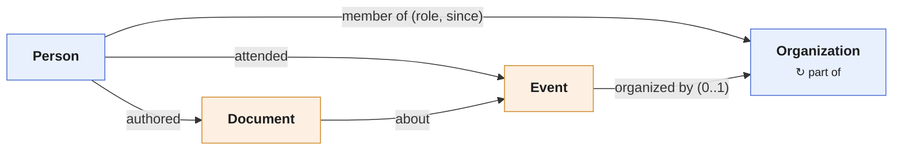

# base

## What it models

The four types nearly every app mentions: who (Person, Organization), when (Event) and what was written down (Document). It's deliberately small. Apps built on Omnigraph install it first so their own types can point at the same Person and Organization, instead of each app keeping its own copy. Domain ontologies (CRM, tasks, meetings) add their types on top and link to these.

## Entities

- **Person**: one node per human, keyed by `slug`, with an optional unique `email` and a `title`.
- **Organization**: a company, nonprofit, government body or team (`kind`), keyed by `slug`, with an optional unique `domain`.
- **Event**: something that happens at a time: `starts_at` (indexed), `ends_at`, a free-text `location`.
- **Document**: content with an address: `kind` (doc, page, file, thread, email, recording), `title` (indexed), an optional unique `url`, `created_at`.

Person, Organization and Event share a `Named` interface (`name`).

## Relations

- Person → MemberOf → Organization [0..*], with `role` and `since`
- Organization → PartOf → Organization [0..1]
- Person → Attended → Event [0..*]
- Event → OrganizedBy → Organization [0..1]
- Person → Authored → Document [0..*]
- Document → DocumentAbout → Event [0..*]

## Modeling decisions

- Readable `slug` keys (`ada-lovelace`, `acme`) instead of opaque ids, so agents can write links without a lookup first.
- A team is an Organization with `kind: team` and a `PartOf` edge to its company. One type covers the whole org chart.
- `location` on Event is free text. Promote it to a Place node (see `schemaorg-core`) only if places are shared and queried.
- No Document → Person "mentions" edge: Omnigraph edges have one target type, and mentions usually belong to a domain ontology with its own rules.

## How to integrate

- **Omnigraph**: copy `base.pg` into your schema first. Domain ontologies reference `Person`, `Organization`, `Event` and `Document` by name. Compile with `omnigraph init --schema base.pg <tmp>`, or plan with `omnigraph schema plan` on a live graph.
- **Other stores**: start from the derived files. SQL: four tables (`person`, `organization`, `event`, `document`) plus join tables, in `base.hcl`. Neo4j: `base.cypher`. GraphQL: `base.graphql`.
- **Overlaps**: Person ≈ schema:Person, foaf:Person, prov:Person. Organization ≈ schema:Organization, foaf:Organization. Event ≈ schema:Event. Document ≈ schema:CreativeWork, foaf:Document.
- If your project already has `User`, map it to Person and keep login details on User (or on an Actor type, as in `company-brain`).

## Files

- `base.pg`: **canonical.** The schema in Omnigraph's schema language; compiles on Omnigraph 0.14 and 0.15. Edit this one.
- `base.cypher`: Neo4j 5 constraints and indexes, generated from `base.pg`. Relationship rules and enums are comments, since Cypher has no relationship schema; existence and type constraints need Neo4j Enterprise.
- `base.graphql`: a GraphQL schema, generated from `base.pg`. Edges are fields in both directions, and MemberOf is a `Membership` type. No keys or uniqueness.
- `base.hcl`: Atlas HCL for PostgreSQL, generated from `base.pg`. Tables keyed by `slug`; `PartOf` and `OrganizedBy` are foreign keys, the other edges join tables.
