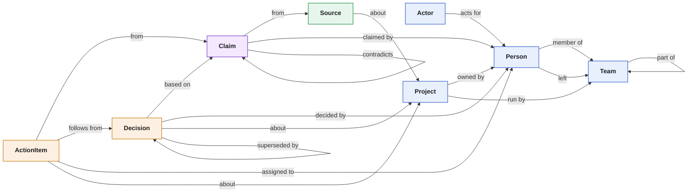

# Company brain

## What it models

The memory of one company, kept coherent by its people and by their agents. It has four layers, connected only by named edges:

- **People and org:** Person, Actor, Team, Project.
- **Evidence:** Source (a meeting, thread, document, email or ticket).
- **Claims:** what someone said in a source, quoted exactly.
- **Facts:** the Decisions and ActionItems promoted from claims after review.

## Entities

- **Person**: someone in the real world, one node per human, with unique `email`, `slack` and `github` handles. Being a Person grants no access.
- **Actor**: someone who reads or writes the graph: a person's login or a software agent (`kind`: human or agent). Its `slug` is the Omnigraph actor id.
- **Team**: an organizational unit; the company itself is the root team.
- **Project**: a time-bound effort with a `status` and a `target_date`.
- **Source**: a record the brain learned from. Its `slug` is `<system>:<native id>`, so ingesting twice doesn't duplicate.
- **Claim**: one statement as it was made: exact `quote`, one-sentence `statement`, `kind` (fact, proposal, commitment, risk), `status` (unverified until reviewed).
- **Decision**: a verified fact about what was decided, never rewritten. A change is a new Decision that supersedes the old one.
- **ActionItem**: a task that follows from claims or a decision, with an assignee.

## Relations

- Person → MemberOf / LeftTeam → Team [0..*] (each stint keyed by its start date)
- Team → PartOf → Team [0..1]
- Actor → ActsFor → Person [0..1]
- Project → OwnedBy → Person [0..1], RunBy → Team [0..1]
- Source → SourceAbout → Project [0..*]
- Claim → ClaimFrom → Source [1], ClaimedBy → Person [1], Contradicts → Claim [0..*]
- Decision → BasedOn → Claim [1..*], DecidedBy → Person [0..*], DecisionAbout → Project [1], SupersededBy → Decision [0..1]
- ActionItem → ActionFrom → Claim [1..*], FollowsFrom → Decision [0..1], AssignedTo → Person [0..1], ActionAbout → Project [0..1]

## Modeling decisions

- **Extracting is not deciding.** Agents record what was said as claims; a separate review step promotes claims to decisions and action items.
- **Facts rest on claims, and claims quote their source,** with typed edges, never a free-text source field.
- **Decisions are never rewritten.** "Current", "superseded" and "contested" are derived by queries, not stored.
- **Creating is not overwriting.** Each create writes one edge capped at one, so creating an existing slug fails with a `@card` violation instead of silently resetting a reviewed row.
- **Two kinds of time:** when something happened (`occurred_at`, `decided_at`) and when the brain learned it (`recorded_at`, plus commit history).

## How to integrate

- **With `base`**: Person and Project overlap. Team maps onto `base` Organization with `kind: team` if you install both; pick one and rename the edges.
- **With `prov-o`**: Source ≈ prov:Entity, Actor ≈ prov:Agent, ClaimFrom ≈ wasDerivedFrom.
- **Outside Omnigraph**: the review workflow relies on `@card` limits and on branches (agents write on a branch, a person merges). In SQL, use unique constraints plus a `status` column and a review queue.
- The upstream cookbook also has the queries, seed data and agent instructions. Start there if you're building the app, not just borrowing the model.

## Files

- `schema.pg`: **canonical.** The schema from the Omnigraph cookbooks (`company-brain/schema.pg`), unmodified, MIT licensed. Compiles on Omnigraph 0.14 and 0.15. Edit this one.
- `schema.cypher`: Neo4j 5 constraints and indexes, generated from `schema.pg`. Relationships, their cardinality and enum values are comments; existence and type constraints need Neo4j Enterprise. The `@card` rules that keep reviewed rows from being overwritten are not enforced.
- `schema.graphql`: a GraphQL schema, generated from `schema.pg`. Edges with properties (MemberOf, LeftTeam, SupersededBy) are `…Edge` types. No keys or uniqueness.
- `schema.hcl`: Atlas HCL for PostgreSQL, generated from `schema.pg`. Single-target edges are foreign keys, the rest join tables. "At least one" (BasedOn, ActionFrom) can't be expressed in SQL and is left to the application.
