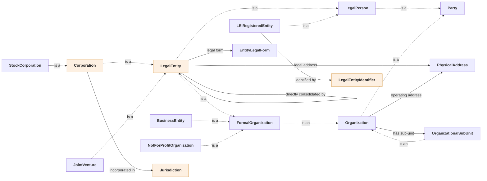

# FIBO Legal Entities

## What it models

Who a company legally is. The Financial Industry Business Ontology (FIBO) is the EDM Council's standard vocabulary for finance; this package is its **Legal Entities** module (`BE/LegalEntities`) plus exactly the files it imports, and nothing else. It covers legal persons and legal entities, kinds of corporation, the jurisdiction a company is incorporated in, its legal form (ISO 20275), its Legal Entity Identifier (LEI, ISO 17442), its registered and operating addresses, and parent–child consolidation as reported to GLEIF.

Use it for KYC and onboarding, counterparty and supplier records, company registries, or any schema where "customer" or "vendor" is really a legal entity. Full FIBO is far larger; banks typically take the parts they need and extend them in their own namespace. This package is that pattern, ready made.

FIBO's most basic terms (Party, Organization, LegalPerson, LegalEntity, Identifier) live in the OMG Commons Ontology Library, so the package ships the Commons modules too.

## Entities

- **Party** (Commons): a person or organization. The root of everything below.
- **LegalPerson** (Commons): a party the law recognizes as having rights and obligations: it can sue and be sued, sign contracts, own property. A natural person can be one (`LegallyCompetentNaturalPerson`).
- **Organization** (Commons): a framework of authority within which people act toward some purpose. **FormalOrganization** is one recognized in some jurisdiction.
- **LegalEntity** (Commons): both a FormalOrganization and a LegalPerson: a partnership, corporation or other organization that can negotiate contracts, take on obligations and pay debts.
- **BusinessEntity**: a formal organization set up under commercial law to do business. `JointStockCompany` is one.
- **Corporation**: a legal entity distinct from its owners, incorporated under the laws of a jurisdiction. Subtypes: **StockCorporation** (has shareholders; `PubliclyHeldCompany`, `PrivatelyHeldCompany`), `ForProfitCorporation`, `NotForProfitCorporation` (`BenefitCorporation`, `ReligiousCorporation`, …).
- **NotForProfitOrganization**: uses its surplus to pursue its purpose. `NonGovernmentalOrganization` is one.
- **JointVenture**: a legal entity formed by parties that pool resources for a specific task.
- Other legal entities: `SpecialPurposeVehicle`, `StatutoryBody`, `CharteredLegalPerson`, `VariableInterestEntity`.
- **OrganizationalSubUnit** (Commons): a part of an organization, recognized only inside it: `Branch`, `Division`.
- **LEIRegisteredEntity**: a legal person identified by an LEI. Defined by having one: anything with an LEI is one.
- **LegalEntityIdentifier**: the 20-character ISO 17442 code. Also `RegistrationIdentifier` (the company-register number) and `ValueAddedTaxIdentificationNumber`.
- **EntityLegalForm**: the legal form in its jurisdiction (GmbH, LLC, SA), coded per ISO 20275 as an `EntityLegalFormIdentifier`.
- **Jurisdiction** (Commons): the area whose law applies.
- **PhysicalAddress**: a postal location; `ConventionalStreetAddress` is the usual subtype.

## Relations

- Corporation → isIncorporatedIn → Jurisdiction [1]
- Corporation → hasLegalName → text [1..*]
- Corporation → isConstitutedBy → InstrumentOfIncorporation [0..*] (articles of association)
- Corporation → hasDateOfIncorporation → date [0..*]
- LegalEntity → hasLegalForm → EntityLegalForm [0..*]
- LegalEntity → hasLegalAddress → PhysicalAddress [0..*]
- Party → hasRegisteredAddress → PhysicalAddress [0..*]
- Organization → hasOperatingAddress → PhysicalAddress [0..*]; also hasHeadquartersAddress
- LEIRegisteredEntity → isIdentifiedBy → LegalEntityIdentifier [1..*] (inverse: identifies)
- LegalEntity → isDirectlyConsolidatedBy → LegalEntity [0..*] (the direct parent, GLEIF level 2)
- LegalEntity → isUltimatelyConsolidatedBy → LegalEntity [0..*] (the ultimate parent; both are subproperties of isConsolidatedBy)
- LegalEntity → isInternationalBranchOf → LegalEntity [0..*]
- Organization → hasSubUnit → OrganizationalSubUnit [0..*] (inverse: isSubUnitOf)
- LegalEntity → hasEquity → OwnersEquity [0..*]

## Modeling decisions

- **Roles and situations, not flags.** FIBO models "owner", "shareholder", "director" as roles a party plays in a situation (`Ownership`, `Control`), not as properties of the company. That's why ownership lives in `fibo/FND/OwnershipAndControl/Ownership.rdf` and needs a node per relationship.
- **LegalPerson vs LegalEntity.** A LegalPerson is anything with legal rights, people included. A LegalEntity is an *organization* that is a legal person. Most "company" records are LegalEntity.
- **Consolidation follows GLEIF.** The parent properties mirror the LEI Level 2 data ("who owns whom") that GLEIF publishes, with direct and ultimate parents as separate links.
- **Identifiers are things, not strings.** An LEI is an `Identifier` node that `identifies` the entity and belongs to a scheme, so one entity can carry an LEI, a register number and a VAT number without confusion.
- Not included: FIBO's other BE modules: Partnerships, PrivateLimitedCompanies, SoleProprietorships, Trusts, OwnershipAndControl (corporate ownership and control), Corporations (officers, directors, shares), GovernmentEntities and FunctionalEntities. Pull those from FIBO if you need them.

## How to integrate

- **Find your existing type first.** "Customer", "Company", "Account", "Vendor", "Counterparty" usually *is* LegalEntity, or Party when people are mixed in. Map onto it; don't add a parallel table.
- **Property graph (Omnigraph `.pg`, Neo4j)**: collapse Party → LegalPerson → Organization → LegalEntity into one `LegalEntity` node with a `kind` enum (`corporation`, `not_for_profit`, `joint_venture`, `branch`, …). Put `lei`, `legal_name`, `jurisdiction` (ISO 3166 code) and `legal_form` (ISO 20275 ELF code) on it as properties, `@unique` on `lei`. Keep consolidation as edges: `DirectParent: LegalEntity -> LegalEntity`, `UltimateParent: LegalEntity -> LegalEntity`. Turn identifiers into nodes only if you hold several schemes per entity.
- **SQL**: a `legal_entities` table with the same columns; `parent_id` and `ultimate_parent_id` as self-references, or a `consolidations` join table if you keep history. Addresses in their own table with a `type` (`legal`, `registered`, `headquarters`, `operating`).
- **Data to load**: GLEIF publishes every LEI with legal name, jurisdiction, ELF code, addresses and parents, free, as the "golden copy" files and an API (https://www.gleif.org/). It fits this model one to one.
- **Overlaps**: schema.org `Organization` (`legalName`, `leiCode`, `parentOrganization`) and FOAF `Organization` map onto Organization/LegalEntity. PROV's `Agent` overlaps Party.
- **What's lost** in a graph or SQL translation: OWL reasoning (a thing with an LEI being *inferred* to be an LEIRegisteredEntity), the role/situation pattern unless you keep those nodes, and the exact-one cardinality on jurisdiction unless you add a constraint.
- **Using the RDF as is**: load the files into a triple store or Protégé. Every `owl:imports` target is in the package. Load the whole folder, or map the import IRIs to these files (Protégé's catalog, Jena's location mapper); otherwise the tool fetches them from the web.

## Files

All `.rdf` files are RDF/XML, copied unmodified. FIBO files keep their FIBO paths under `fibo/`; Commons modules are in `commons/`. `LICENSE` is FIBO's MIT license; the Commons files carry the same MIT text in their `dct:license`. © 2013–2025 EDM Council, Inc. and Object Management Group, Inc.

The four Legal Entities modules:

| File | What |
|---|---|
| `fibo/BE/LegalEntities/LegalPersons.rdf` | Legal persons, business entities, special purpose vehicles, business licenses |
| `fibo/BE/LegalEntities/CorporateBodies.rdf` | Corporations and their kinds, incorporation, jurisdiction, registration identifiers |
| `fibo/BE/LegalEntities/FormalBusinessOrganizations.rdf` | Branches, divisions, joint ventures, not-for-profits, addresses, VAT numbers |
| `fibo/BE/LegalEntities/LEIEntities.rdf` | LEI, entity legal forms (ISO 20275), consolidation relationships (GLEIF) |

FIBO Foundations (FND) modules they import:

| File | What |
|---|---|
| `fibo/FND/Accounting/CurrencyAmount.rdf` | Currencies and monetary amounts |
| `fibo/FND/AgentsAndPeople/People.rdf` | People and their identifying information |
| `fibo/FND/Agreements/Agreements.rdf` | Agreements and commitments |
| `fibo/FND/Agreements/Contracts.rdf` | Contracts and contract parties |
| `fibo/FND/Arrangements/Arrangements.rdf` | Arrangements and structured collections |
| `fibo/FND/Arrangements/ClassificationSchemes.rdf` | Classification schemes |
| `fibo/FND/Arrangements/Documents.rdf` | Documents and records |
| `fibo/FND/Arrangements/IdentifiersAndIndices.rdf` | Identifiers and identification schemes |
| `fibo/FND/DatesAndTimes/FinancialDates.rdf` | Dates, schedules and periods |
| `fibo/FND/DatesAndTimes/Occurrences.rdf` | Events and occurrences |
| `fibo/FND/GoalsAndObjectives/Objectives.rdf` | Goals and objectives (profit, not-for-profit) |
| `fibo/FND/Law/LegalCapacity.rdf` | Legal capacity, rights, licenses |
| `fibo/FND/Law/LegalCore.rdf` | Law, jurisdiction, constitutions |
| `fibo/FND/OwnershipAndControl/Ownership.rdf` | Ownership situations, owners, assets, equity |
| `fibo/FND/Parties/Parties.rdf` | Party roles and situations |
| `fibo/FND/Places/Addresses.rdf` | Addresses |
| `fibo/FND/Relations/Relations.rdf` | Generic relations (names, ownership, control) |
| `fibo/FND/Utilities/Analytics.rdf` | Measures and statistics |
| `fibo/FND/Utilities/AnnotationVocabulary.rdf` | FIBO's annotation properties |

OMG Commons modules that FIBO imports:

| File | What |
|---|---|
| `commons/AnnotationVocabulary.rdf` | Annotation properties (synonym, abbreviation, …) |
| `commons/BusinessAuthorizations.rdf` | Authorizations and licenses |
| `commons/Classifiers.rdf` | Classifiers and classification schemes |
| `commons/CodesAndCodeSets.rdf` | Codes and code sets |
| `commons/Collections.rdf` | Collections and constituents |
| `commons/ContextualDesignators.rdf` | Names in context |
| `commons/ContextualIdentifiers.rdf` | Identifiers in context |
| `commons/DatesAndTimes.rdf` | Dates and times |
| `commons/Designators.rdf` | Names, designations, descriptions |
| `commons/Documents.rdf` | Documents and records |
| `commons/Identifiers.rdf` | Identifiers and identification schemes |
| `commons/Locations.rdf` | Countries, regions, geopolitical entities |
| `commons/Organizations.rdf` | Organization, FormalOrganization, LegalPerson, LegalEntity |
| `commons/PartiesAndSituations.rdf` | Party, roles, situations |
| `commons/QuantitiesAndUnits.rdf` | Quantities and units |
| `commons/RegistrationAuthorities.rdf` | Registries and registration authorities |
| `commons/RegulatoryAgencies.rdf` | Regulators, jurisdictions |
| `commons/RolesAndCompositions.rdf` | Roles and part-whole |
| `commons/SitesAndFacilities.rdf` | Sites and facilities |
| `commons/TextDatatype.rdf` | Text datatype |
