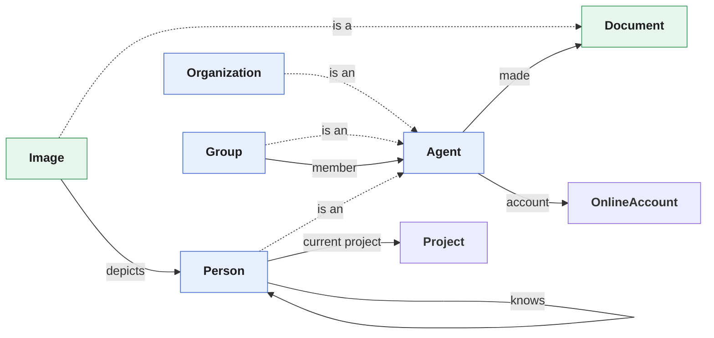

# FOAF

## What it models

People and their links: who someone is, what they made, which groups they belong to, which online accounts they hold and whom they know. It's one of the oldest and most reused vocabularies on the web of data. Vocabulary version 0.99 (2014), unchanged.

## Entities

- **Agent**: anything that can act: a person, an organization, a group, software. Has `name`, `mbox` (email), `homepage`, `account`.
- **Person**: an Agent that's a human. Adds `givenName`, `familyName`, `img`, `interest`, `knows`.
- **Organization**: an Agent that's a social institution (a company, a society).
- **Group**: a collection of agents, with `member`.
- **Document**: anything with content (a page, a file). Has `topic`, `primaryTopic`.
- **Image**: a Document that's a picture, with `depicts`.
- **OnlineAccount**: an account on a service, with `accountName` and `accountServiceHomepage`.
- **Project**: something an agent works on (marked unstable in the spec).

## Relations

- Person → knows → Person [0..*]
- Group → member → Agent [0..*]
- Agent → made → Document or any Thing [0..*] (inverse: maker)
- Agent → account → OnlineAccount [0..*]
- Image → depicts → any Thing [0..*] (inverse: depiction)
- Document → primaryTopic → any Thing [0..1] (inverse: isPrimaryTopicOf)
- Person → currentProject / pastProject → Project or any Thing [0..*]

## Modeling decisions

- FOAF identifies people indirectly: `mbox` and `mbox_sha1sum` are inverse-functional, so two descriptions with the same email are the same person. There's no central id.
- `knows` is deliberately loose: it means some reciprocated interaction, not friendship. FOAF doesn't define it as symmetric.
- Several terms are marked "testing" or "unstable" in the spec (Project among them). They are widely used anyway.

## How to integrate

- **Person/Organization** overlap almost every schema's users, contacts and companies. Map onto those rather than adding new types; keep FOAF's `mbox`-style dedupe rule as a unique email.
- **Group** is often a team or a mailing list. If you already have Team, use it, with `member` as a membership edge.
- **Property graph**: Agent becomes an interface (Omnigraph `interface`) that Person, Organization and Group implement. `made` and `depicts` point at any Thing, so they need one edge per target type in a typed schema.
- **What's lost**: inverse-functional identity (a reasoner would merge two people with the same email). In a database it's a unique constraint plus a merge step.
- Pairs naturally with `prov-o` (Agent ↔ prov:Agent) and `schemaorg-core` (Person ↔ schema:Person).

## Files

- `foaf.rdf`: the FOAF vocabulary in RDF/XML from http://xmlns.com/foaf/spec/index.rdf, unmodified. By Dan Brickley and Libby Miller, licensed CC BY 1.0.
