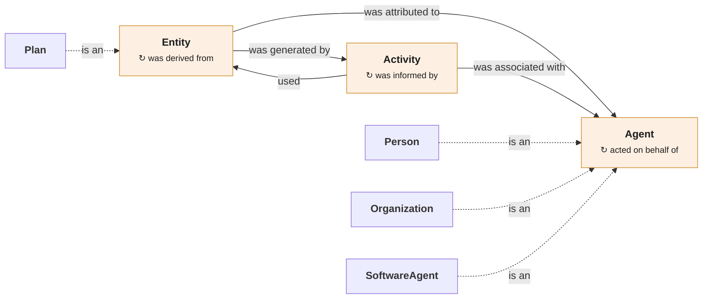

# PROV-O

## What it models

Where data came from. PROV-O has three core types: an **Entity** is a thing (a file, a record, a report), an **Activity** happens over time and uses or generates entities, and an **Agent** bears responsibility for activities and entities. Use it for lineage, audit trails, citations and "who changed what, from what". This is the W3C Recommendation (2013), unchanged.

## Entities

- **Entity**: a physical, digital or conceptual thing with fixed aspects. Subtypes: Bundle, Collection, Plan.
- **Activity**: something that occurs over a period of time and acts on entities. Has `startedAtTime` and `endedAtTime`.
- **Agent**: something responsible for an activity or an entity. Subtypes: Person, Organization, SoftwareAgent.
- **Plan**: an Entity describing the steps an agent intended to follow (a recipe, a workflow, a policy).

PROV-O also has *qualified* forms (Usage, Generation, Association, Derivation, …): one class per relation, for when the relation itself needs properties such as time, role or plan.

## Relations

- Entity → wasGeneratedBy → Activity [0..*]
- Activity → used → Entity [0..*]
- Activity → wasInformedBy → Activity [0..*]
- Entity → wasDerivedFrom → Entity [0..*] (subproperties: wasRevisionOf, wasQuotedFrom, hadPrimarySource)
- Entity → wasAttributedTo → Agent [0..*]
- Activity → wasAssociatedWith → Agent [0..*]
- Agent → actedOnBehalfOf → Agent [0..*]
- Entity → wasInvalidatedBy → Activity [0..*]

## Modeling decisions

- Relations point backwards in time (`wasGeneratedBy`, `used`, `wasDerivedFrom`): provenance is written about what already happened.
- The starting-point terms above cover most uses. The qualified pattern exists because RDF can't put properties on a relation; it's the price of the format, not extra meaning.
- PROV-O doesn't define what a Person or Organization is beyond being an Agent; pair it with FOAF or schema.org for that.

## How to integrate

- **Property graph (Omnigraph `.pg`, Neo4j)**: the qualified classes collapse into edge properties. `Generation(atTime, role)` becomes `WasGeneratedBy: Entity -> Activity { at_time: DateTime? role: String? }`. That's simpler than the RDF.
- **Agent** usually maps onto existing users, people, service accounts or bots. Reuse those types and mark them as agents rather than adding a parallel Agent table.
- **Entity** is often several of your types (documents, records, datasets). Either add the PROV edges to each type, or keep a thin `Entity` node that points at them.
- **SQL**: an `activities` table, plus join tables `used`, `generated` and `associated_with`. Time-ordered lineage queries need recursive CTEs.
- **What's lost**: OWL inference of superproperties (a `wasRevisionOf` is also a `wasDerivedFrom`); write both edges, or query both.

## Files

- `prov-o.ttl`: the PROV-O OWL ontology from https://www.w3.org/ns/prov-o, unmodified. © 2013 W3C (MIT, ERCIM, Keio, Beihang), distributed under the W3C Software and Document License.
