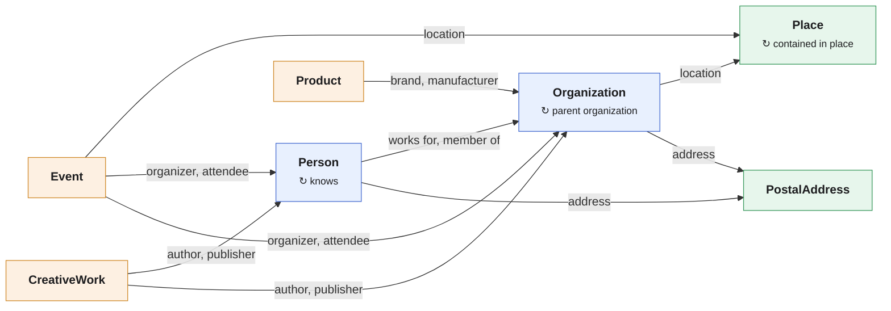

# schema.org core

## What it models

The handful of schema.org types that nearly every domain touches: who (Person, Organization), where (Place, PostalAddress), when (Event), what was made (CreativeWork) and what is sold (Product). Search engines and most structured-data tools already read these terms, so a schema built on them lines up with the rest of the web. This is a curated subset of about 800 schema.org types; everything else is left out.

## Entities

- **Person**: `name`, `givenName`, `familyName`, `email`, `jobTitle`, `birthDate`, `address`.
- **Organization**: `name`, `legalName`, `email`, `foundingDate`, `address`, `location`.
- **Place**: `name`, `address`, `latitude`, `longitude`.
- **Event**: `name`, `startDate`, `endDate`, `location`, `eventStatus`, `about`.
- **CreativeWork**: `name`, `dateCreated`, `datePublished`, `inLanguage`, `about`. The parent of Article, Book, Dataset, SoftwareSourceCode and many more in full schema.org.
- **Product**: `name`, `sku`, `gtin`, `brand`, `manufacturer`.
- **PostalAddress**: `streetAddress`, `addressLocality`, `postalCode`, `addressCountry`.

All of them inherit `name`, `description`, `url`, `identifier` and `sameAs` from Thing.

## Relations

- Person → worksFor → Organization [0..*]
- Person → memberOf → Organization [0..*]
- Person → knows → Person [0..*]
- Organization → parentOrganization → Organization [0..1 in practice]
- Organization → employee → Person [0..*]
- Organization, Event → location → Place [0..*]
- Place → containedInPlace → Place [0..1 in practice]
- Event → organizer → Person or Organization [0..*]
- Event → attendee → Person or Organization [0..*]
- CreativeWork → author / publisher → Person or Organization [0..*]
- CreativeWork, Event → about → any Thing [0..*]
- Product → brand / manufacturer → Organization [0..*]
- Person, Organization, Place → address → PostalAddress [0..*]

## Modeling decisions

- schema.org uses `domainIncludes`/`rangeIncludes`, not `rdfs:domain`/`rdfs:range`. They are hints, not constraints: any property may appear on any type, and values are often plain text even where a type is expected.
- Many properties accept several types (an organizer is a Person *or* an Organization). That is the main thing to resolve when moving to a typed schema.
- Kept: the seven types most schemas need, and the properties that link them. Dropped: actions, offers and prices, ratings, medical and many other domain extensions.
- Dates are ISO 8601 text in schema.org; `startDate` may be a Date or a DateTime.

## How to integrate

- **Property graph or SQL**: one node or table per type. Each multi-type relation (`organizer`, `author`, `attendee`) becomes one edge per target type (`OrganizedByPerson`, `OrganizedByOrganization`) or goes through a shared parent type. In Omnigraph, write two edges, since an edge has exactly one target type.
- **Existing `User`/`Account`/`Company` tables** usually map onto Person and Organization: reuse them and add `sameAs` for external ids.
- `address` can stay a nested value (columns on the owner) unless addresses are shared between owners.
- **What's lost**: the open, hint-based typing. A strict schema will refuse data that schema.org would accept. Keep a free-text fallback field where your sources are messy.
- Keep the schema.org IRIs (in a `sameAs` or mapping table) if you publish JSON-LD; search engines read them.

## Files

- `schemaorg-core.ttl`: the subset in Turtle, using schema.org IRIs. Licensed CC BY-SA 3.0 by schema.org; derived works must keep that license.
