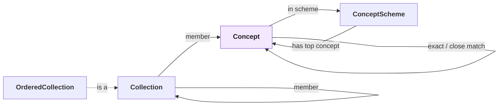

# SKOS

## What it models

Controlled vocabularies: tag sets, category trees, thesauri, classification schemes. A **Concept** is a unit of meaning with labels in several languages, arranged into hierarchies with `broader`/`narrower` and linked sideways with `related`. Concepts belong to a **ConceptScheme** and can be mapped to concepts in other schemes. This is the W3C Recommendation (2009), unchanged.

## Entities

- **Concept**: an idea or category. Labels: `prefLabel` (one per language), `altLabel` (synonyms) and `hiddenLabel` (misspellings for search). Plus `notation` (a code like `004.6`), and notes: `definition`, `scopeNote`, `example`.
- **ConceptScheme**: a vocabulary that concepts belong to, with `hasTopConcept` for its roots.
- **Collection**: a labelled group of concepts that isn't a hierarchy node ("fruits by color").
- **OrderedCollection**: a Collection whose `memberList` has an order.

## Relations

- Concept → broader → Concept [0..*] (inverse: narrower)
- Concept → related → Concept [0..*] (symmetric)
- Concept → inScheme → ConceptScheme [0..*]
- ConceptScheme → hasTopConcept → Concept [0..*] (inverse: topConceptOf)
- Collection → member → Concept or Collection [0..*]
- Concept → exactMatch / closeMatch / broadMatch / narrowMatch / relatedMatch → Concept in another scheme [0..*]

## Modeling decisions

- Concepts are not classes. SKOS is for organizing ideas (a subject index), not for typing data, so `broader` isn't `subClassOf`, and a Concept has no instances.
- `broader` is deliberately not transitive; `broaderTransitive` exists for queries that want the closure.
- Mapping properties (`exactMatch` and the rest) are for links *between* schemes. Within one scheme, use `broader`/`related`.
- One `prefLabel` per language per concept, enforced by convention, not by OWL.

## How to integrate

- **Tags, categories and topics** in an app are SKOS concepts. Model them as a Concept node with a `Broader` edge to itself, plus a `Scheme` node; the rest of your schema links to Concept (`Article → Topic → Concept`).
- **Labels**: store `pref_label` per language (a JSON map or a labels table) and `alt_labels` as a list, so search and display both work.
- **Property graph**: `broader` and `related` become self-edges on Concept. `@unique(@src, @dst)` stops duplicates. Cycles in `broader` are legal in SKOS but usually a data error; check for them.
- **SQL**: a `concepts` table with a `parent_id` covers single-parent trees. A join table covers polyhierarchy, which SKOS allows.
- **What's lost**: language-tagged literals become plain fields unless you keep a language column.

## Files

- `skos.rdf`: the SKOS core vocabulary in RDF/XML from https://www.w3.org/2009/08/skos-reference/skos.rdf, unmodified. © 2009 W3C, distributed under the W3C Software and Document License.
