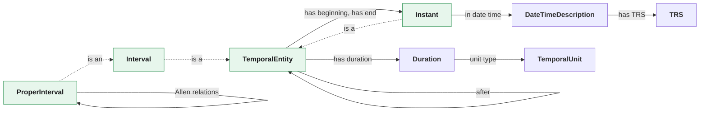

# OWL-Time

## What it models

Time as things you can point at. An **Instant** is a point; an **Interval** has a beginning and an end; a **Duration** is a length of time. Intervals relate to each other with Allen's interval relations (before, meets, overlaps, during…). Positions in time can be plain timestamps, positions in another reference system (a geological era, Unix time), or calendar descriptions with gaps ("some day in March 2024"). This is the W3C/OGC Candidate Recommendation (2017–2022), unchanged.

## Entities

- **TemporalEntity**: the parent of Instant and Interval. Has `hasBeginning`, `hasEnd`, `hasDuration`.
- **Instant**: a position on the timeline. `inXSDDateTimeStamp` for an exact timestamp, `inDateTime` for a calendar description, `inTimePosition` for other systems.
- **Interval** / **ProperInterval**: a stretch of time; a proper interval's beginning and end differ.
- **Duration**: an amount of time in a temporal unit (`numericDuration` + `unitType`).
- **DateTimeDescription**: a calendar date split into fields (`year`, `month`, `day`, `hour`…), any of which may be missing.
- **TemporalUnit**: second, minute, hour, day, week, month, year.
- **TRS**: a temporal reference system (Gregorian, Unix time, geological time).

## Relations

- TemporalEntity → hasBeginning / hasEnd → Instant [0..1]
- TemporalEntity → hasDuration → Duration [0..*]
- Instant → inDateTime → DateTimeDescription [0..*]
- Instant → before / after → TemporalEntity [0..*]
- ProperInterval → intervalBefore / intervalMeets / intervalOverlaps / intervalDuring / intervalStarts / intervalFinishes / intervalEquals … → ProperInterval [0..*] (Allen's 13 relations, each with its inverse)
- Duration → unitType → TemporalUnit [1]
- TemporalPosition → hasTRS → TRS [1]

## Modeling decisions

- Points and intervals are separate types, so "the meeting" (an interval) and "when it started" (an instant) are distinct things you can link to.
- Calendar descriptions let you say "March 2024" without inventing a day; most databases can't.
- Allen's relations are given as properties so a reasoner can check consistency; most systems compute them from begin/end instead.

## How to integrate

- **Most apps need only part of it**: an event or task with `starts_at` and `ends_at` timestamps *is* an Interval. Keep the fields; adopt the vocabulary (`hasBeginning`/`hasEnd`) in names or mappings.
- **Promote to nodes only when time is shared or uncertain**: several things pointing at the same period (a sprint, a fiscal quarter), or partial dates from historical sources. A `Period` node with `starts_at`, `ends_at` and a precision field covers it.
- **Allen relations** become queries (`a.ends_at < b.starts_at`), not stored edges.
- **Durations**: store them as an ISO 8601 string or as seconds plus a display unit.
- **What's lost**: OWL consistency checks between interval relations, and calendar systems other than Gregorian unless you keep a TRS field.

## Files

- `time.ttl`: the OWL-Time ontology from https://www.w3.org/2006/time, unmodified. © 2006–2017 W3C and OGC, licensed CC BY 4.0 (as stated in the file).
